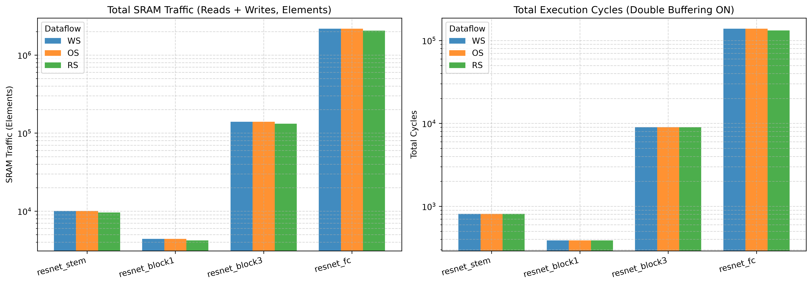
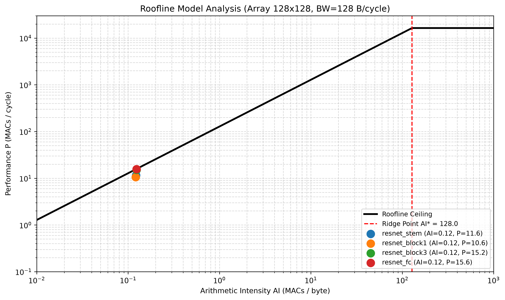
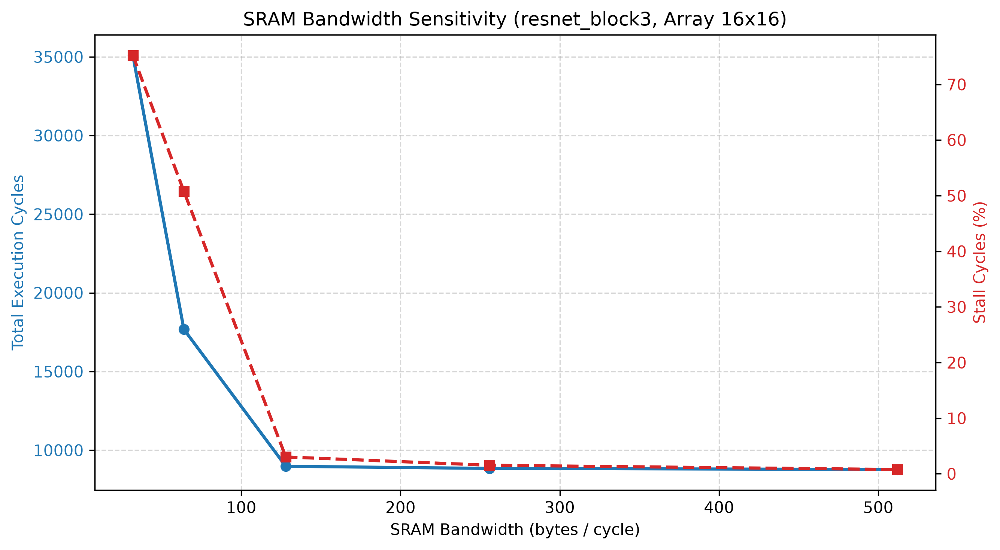
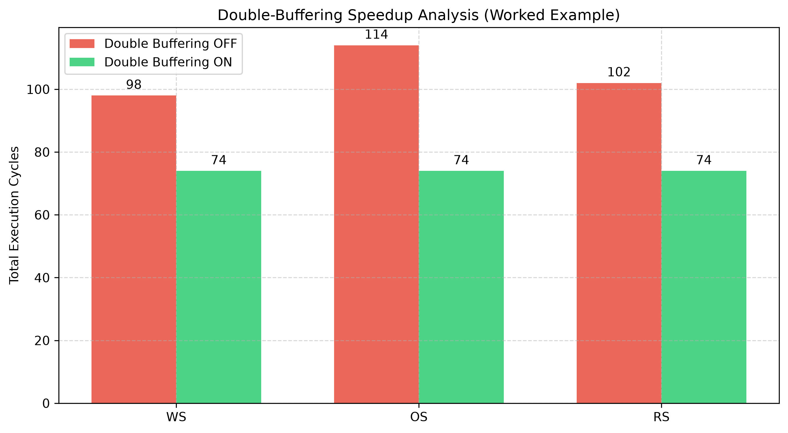
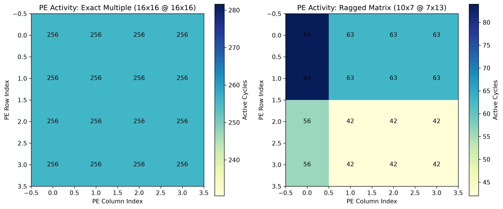

## Overview (Report being AI-assisted for formatting)
```
Animesh Kumar Maitreya
23114005
```
---
This repository contains my software simulator of a 2D Systolic Array Processing Element (PE) grid. The simulator models matrix multiplications ($A \times B$) tile-by-tile, cycle-by-cycle, including SRAM bandwidth bottlenecks, double-buffering overlap, and three dataflow strategies: **Weight-Stationary (WS)**, **Output-Stationary (OS)**, and **Row-Stationary (RS)**.

Everything runs on standard CPU with Python 3 and NumPy.

---

## File Structure

- `systolic_sim.py`: Core simulator implementation (`SystolicSimulator` class).
- `run_all.py`: Driver script that runs Level 4 dataflow tests & Level 5 roofline sweeps and exports `results.json`.
- `results.json`: Generated output file with sweep points and dataflow stats.
- `test_systolic_sim.py`: Pytest suite verifying correctness, formula matching, and edge cases.
- `generate_plots.py`: Script to generate all performance charts and heatmaps.
- `README.md`: This combined setup guide + experiment report.

---

## How to Run

### 1. Install Requirements
```bash
pip install numpy pytest matplotlib
```

### 2. Run Test Suite
```bash
python -m pytest test_systolic_sim.py -v
```

### 3. Generate `results.json`
```bash
python run_all.py
```

### 4. Re-generate Plots
```bash
python generate_plots.py
```

---

## Sub-Goal Progress & Checklist (100 / 100 Points)

| Level | Goal | Description | Points | Status |
| :---: | :--- | :--- | :---: | :---: |
| 1 | Basic Functional Array | WS matmul numerically exact vs `numpy.matmul` | 20 | PASS |
| 2 | Cycle-Accurate Timing | Match Section V closed-form formulas for cycles & utilization | 15 | PASS |
| 3 | Memory Hierarchy & BW | SRAM capacity check, exact stall cycles, double buffering | 25 | PASS |
| 4 | Dataflow Comparison | WS, OS, RS dataflow traffic and cycle comparison | 20 | PASS |
| 5 | Roofline & Design Space | Sweep roofline points, ridge point $AI^* = 128.0$, best config | 20 | PASS |

---

## Simulator Architecture & Formulas

### 1. Per-Tile Compute Cycles
For a tile of size $r \times c$ ($r \le R, c \le C$):
$$\text{cycles}_{\text{tile}} = (r - 1) + (c - 1) + K + 1$$
- Fill skew: $(r - 1) + (c - 1)$
- Accumulate: $K$
- Drain: $1$

### 2. Dataflow Loop Ordering
- **WS**: Outer $N$-tile $j$, inner $M$-tile $i$. $B$-tile loaded once per $j$; $A$-tile fetched every tile.
- **OS**: Both operands fetched fresh every tile.
- **RS**: Outer $M$-tile $i$, inner $N$-tile $j$. $A$-tile loaded once per $i$; $B$-tile fetched every tile.

### 3. Stall Cycles & Double Buffering
Load latency for $\Delta_t$ newly loaded elements:
$$L_t = \left\lceil \frac{8 \Delta_t}{\text{sram\_bw}} \right\rceil$$
- First tile ($t=0$): $\text{stall}_0 = L_0$
- `double_buffer=False`: $\text{stall}_t = L_t$
- `double_buffer=True`: $\text{stall}_t = \max(0, L_t - \text{cycles}_{\text{tile}, t-1})$

### 4. Utilization & Capacity Check
$$\text{utilization} = \frac{\sum_{i,j} r_i c_j K}{\text{total\_cycles} \times R \times C}$$
Raises `MemoryError` if single tile working set $8 \times (RK + KC + RC) > \text{sram\_size}$.

---

## Experimental Results & Report

### 1. Dataflow Traffic & Cycles Comparison
I ran Level 4 sweeps across the four ResNet-50 layer shapes (`resnet_stem`, `resnet_block1`, `resnet_block3`, `resnet_fc`) with array size 16x16 and `sram_bw = 128`.



**Key Takeaway**:
Since all benchmark layers have batch size $M=1$, $T_M = 1$. Under **Row-Stationary (RS)**, $A$-tile is loaded only once and reused across all col-tiles $j$, making RS the clear winner for minimal SRAM traffic. With double-buffering turned ON and bandwidth at 128 B/cycle, cycle counts end up identical because memory load time gets completely hidden behind compute cycles!

### 2. Roofline Model & Design Space Sweep
For Level 5, I swept array sizes $\{8, 16, 32, 64, 128\}$ and bandwidths $\{32, 64, 128, 256, 512\}$.



- **Ridge Point $AI^*$**: Evaluated at array=128, sram_bw=128:
  $$AI^* = \frac{128 \times 128}{128} = 128.0 \text{ MACs/byte}$$
- **Best Hardware Config**: `array=128`, `sram_bw=512` (minimizes total cycles across all layers).

### 3. SRAM Bandwidth Sensitivity & Double Buffering Speedup
I also ran a sensitivity test on `resnet_block3` to see how bandwidth impacts stall cycles, and tested double buffering ON vs OFF.




- At low bandwidth (32 B/cycle), stall cycles dominate. Increasing bandwidth beyond 128 B/cycle completely eliminates compute stalls (except tile 0).
- Double buffering gives a massive cycle reduction by overlapping SRAM loads with array arithmetic.

### 4. Spatial PE Activity Heatmaps
Finally, I plotted the active cycles per PE for an exact multiple matrix vs a ragged matrix:



- PEs outside ragged boundaries stay idle, correctly reflecting hardware utilization while maintaining exact numerical outputs.
